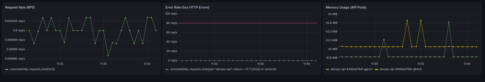
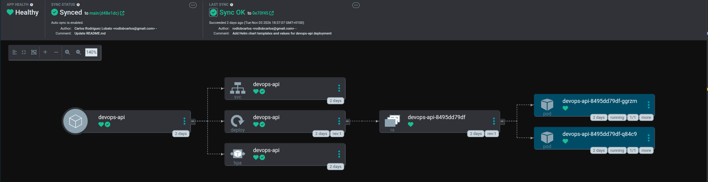

# Cloud-Native DevOps & SRE Showcase Platform

[](https://github.com/rodlobcarlos/devops-end-to-end-project/actions/workflows/ci.yml)


Proyecto monorepo integral que reproduce a coste cero un ciclo de vida de desarrollo de software (SDLC) completo con enfoque Cloud-Native, DevSecOps y observabilidad SRE.

## 🏛 Arquitectura del Sistema

```text
[Desarrollador / Git Push]
         │
         ▼ (Pull Request / Push)
[GitHub Actions]
   │
   ├── 1. CI / DevSecOps
   │      ├── Linters: Ruff & Hadolint
   │      ├── Tests: Pytest
   │      ├── Vulnerability Scan: Trivy (exit-code 1 en HIGH/CRITICAL)
   │      └── Container Build & Push: GHCR
   │
   ├── 2. IaC (Aprovisionamiento)
   │      └── Terraform ──► Clúster Kind (3 Nodos: 1 control-plane, 2 workers)
   │
   ├── 3. GitOps (Despliegue Continuo)
   │      └── ArgoCD ──► Auto-Sync & Reconcile ──► Clúster Kubernetes
   │
   └── 4. Workload & SRE
          └── Pods FastAPI (Multi-stage Distroless, Non-root)
                 ├── HPA: Autoescalado por CPU y Memoria
                 └── Scrape /metrics ──► Prometheus Operator
                                               ├── Grafana (Dashboard RED)
                                               └── PrometheusRules (Alertas 5xx & RAM)
```

## 🛠 Decisiones de Ingeniería y Arquitectura

- **Minimización de superficie de ataque**: El contenedor de producción se compila mediante un enfoque Docker multi-stage sobre base mínima (slim/distroless). No incluye gestores de paquetes ni utilidades del sistema (curl, sh, apt) y se ejecuta bajo un usuario sin privilegios (non-root), mitigando vectores de escalada de privilegios.

- **DevSecOps en CI**: Análisis continuo de vulnerabilidades con Trivy en cada push/PR. Se aplica la política de fallo con severidad CRITICAL y HIGH, configurando ignore-unfixed: true para centrar el bloqueo del pipeline en CVEs con parche disponible sin detener el flujo por dependencias upstream no resueltas.

- **Infraestructura Declarativa**: Aprovisionamiento del clúster local Kind mediante Terraform, garantizando paridad entre entornos de desarrollo y configuraciones reproducibles.

- **GitOps**: ArgoCD actúa como único punto de conciliación de estado deseado contra el clúster a partir de Helm Charts parametrizados.

- **Observabilidad SRE (Metodología RED)**:
    1. **Rate**: Tasa de solicitudes por segundo calculada mediante http_requests_total.
    2. **Errors**: Medición de errores de servidor con status=~"5.*".
    3. **Duration / Resources**: Monitoreo del conjunto activo de memoria por réplica (container_memory_working_set_bytes) para anticipar escenarios de OOMKilled.

- **Alerting Proactivo**: Configuración de un recurso PrometheusRule (devops-api-alerts) que evalúa una ventana temporal (for: 1m) ante ráfagas sostenidas de errores 5xx (>5%) para evitar la fatiga por alertas (alert fatigue).

## Cuadro de Mandos en Grafana
Visualización en tiempo real de peticiones entrantes, ráfagas de error forzadas y consumo de memoria RAM por réplica:



## Estado GitOps en ArgoCD


## 🚀 Guía de Puesta en Marcha Local

Prerrequisitos
- Docker Engine
- Terraform >= 1.5
- Helm 3 & Kubectl
- Kind

### Inicializar Infraestructura con Terraform
```
cd terraform
terraform init
terraform apply -auto-approve
cd ..
```
### Desplegar ArgoCD
```
kubectl create namespace argocd
kubectl apply -n argocd -f [https://raw.githubusercontent.com/argoproj/argo-cd/stable/manifests/install.yaml](https://raw.githubusercontent.com/argoproj/argo-cd/stable/manifests/install.yaml)
kubectl wait --for=condition=available deployment/argocd-server -n argocd --timeout=300s

# Obtener credencial inicial del usuario admin
kubectl -n argocd get secret argocd-initial-admin-secret -o jsonpath="{.data.password}" | base64 -d && echo
```

### Instalar Stack de Observabilidad
```
helm repo add prometheus-community [https://prometheus-community.github.io/helm-charts](https://prometheus-community.github.io/helm-charts)
helm repo update
helm install monitoring prometheus-community/kube-prometheus-stack -n monitoring --create-namespace

# Aplicar monitores de servicio y reglas de alerta
kubectl apply -f helm/templates/servicemonitor.yaml
kubectl apply -f monitoring/alerts/api-rules.yaml
```

### 🌐 Mapeo de Puertos y Puntos de Acceso
Recomiendo ejecutar cada comando en una terminal distinta
| Servicio | Comando Port-Forward | URL Local | Credenciales por Defecto |
| :--- | :--- | :--- | :--- |
| **API Backend** | `kubectl port-forward svc/devops-api -n default 5000:80` | `http://localhost:5000/docs` | N/A (Métricas en `/metrics`) |
| **ArgoCD** | `kubectl port-forward svc/argocd-server -n argocd 8080:443` | `https://localhost:8080` | `admin` / *(Secret descifrado)* |
| **Grafana** | `kubectl port-forward svc/monitoring-grafana -n monitoring 3000:80` | `http://localhost:3000` | `admin` / `prom-operator` |
| **Prometheus** | `kubectl port-forward svc/monitoring-kube-prometheus-prometheus -n monitoring 9090:9090` | `http://localhost:9090` | N/A |

## 🧪 Pruebas de Resiliencia y Simulación de Caos
Para comprobar las alertas en Prometheus Operator y la respuesta de los paneles de Grafana:
```
# Iniciar inyección de tráfico concurrente con fallos inducidos (HTTP 500)
chmod +x scripts/chaos-test.sh
./scripts/chaos-test.sh
```

## 🧹 Limpieza y Destrucción del Entorno
Para eliminar todos los recursos creados y liberar memoria y almacenamiento en el equipo anfitrión:
```
cd terraform
terraform destroy -auto-approve
cd ..
docker system prune -f
```
