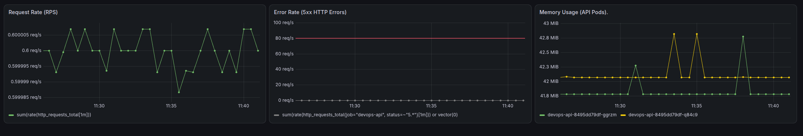
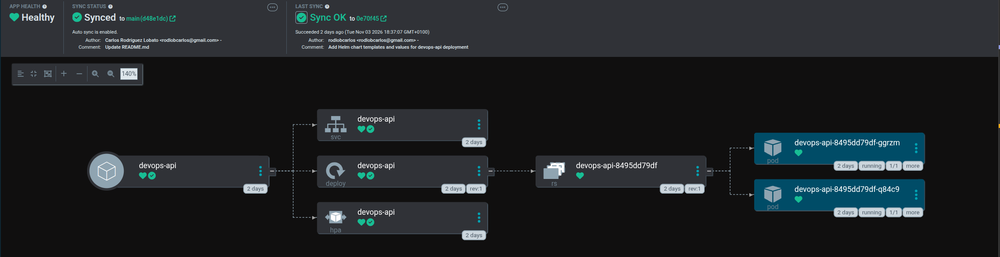

# Cloud-Native DevOps & SRE Showcase Platform

[](https://github.com/rodlobcarlos/devops-end-to-end-project/actions/workflows/ci.yml)


Proyecto monorepo integral que reproduce a coste cero un ciclo de vida de desarrollo de software (SDLC) completo con enfoque Cloud-Native, DevSecOps y observabilidad SRE.

## 🏛 Arquitectura del Sistema

```text
[Desarrollador / Git Push]
         │
         ▼ (Pull Request / Push)
[GitHub Actions (CI / DevSecOps)]
   ├── 1. Linters: Ruff & Hadolint
   ├── 2. Tests: Pytest
   ├── 3. Vulnerability Scan: Trivy (exit-code 1 en HIGH/CRITICAL)
   ├── 4. Container Build & Push: GHCR (tag: commit SHA)
   └── 5. GitOps Update (Python): scripts/update_gitops_tag.py ──┐
                                                                 │ (Actualiza values.yaml)
                                                                 ▼
[Automatización & Tooling (scripts/)]                    [Repositorio Git (Helm)]
   ├── bootstrap.sh (Bash): Orquesta ciclo de vida ──┐           │
   │     ├── Terraform ──► Clúster Kind (3 Nodos)    │           ▼
   │     ├── ArgoCD ─────► Auto-Sync & Reconcile ◄───┼───────────┘
   │     └── Monitoring ─► Prometheus & Grafana      │
   │                                                 ▼
   ├── k8s_doctor.py (Python): Auditoría SRE ──► [Clúster Kubernetes]
   │     └── Genera reporte HTML + consulta alertas   └── Pods FastAPI (Distroless, Non-root)
   │                                                        ├── HPA (CPU & Memoria)
   └── chaos-test.sh (Bash): Inyecta tráfico HTTP 500 ──────┴── /metrics ──► Prometheus & Grafana
```

## 🛠 Decisiones de Ingeniería y Arquitectura

- **Minimización de superficie de ataque**: El contenedor de producción se compila mediante un enfoque Docker multi-stage sobre base mínima (slim/distroless). No incluye gestores de paquetes ni utilidades del sistema (curl, sh, apt) y se ejecuta bajo un usuario sin privilegios (non-root), mitigando vectores de escalada de privilegios.

- **DevSecOps en CI**: Análisis continuo de vulnerabilidades con Trivy en cada push/PR. Se aplica la política de fallo con severidad CRITICAL y HIGH, configurando ignore-unfixed: true para centrar el bloqueo del pipeline en CVEs con parche disponible sin detener el flujo por dependencias upstream no resueltas.

- **Infraestructura Declarativa**: Aprovisionamiento del clúster local Kind mediante Terraform, garantizando paridad entre entornos de desarrollo y configuraciones reproducibles.

- **GitOps**: ArgoCD actúa como único punto de conciliación de estado deseado contra el clúster a partir de Helm Charts parametrizados.

- **Observabilidad SRE (Metodología RED)**:
    1. **Rate**: Tasa de solicitudes por segundo calculada mediante http_requests_total.
    2. **Errors**: Medición de errores de servidor con status=~"5.*".
    3. **Duration / Resources**: Monitoreo del conjunto activo de memoria por réplica (container_memory_working_set_bytes) para anticipar escenarios de OOMKilled.

- **Alerting Proactivo**: Configuración de un recurso PrometheusRule (devops-api-alerts) que evalúa una ventana temporal (for: 1m) ante ráfagas sostenidas de errores 5xx (>5%) para evitar la fatiga por alertas (alert fatigue).

## ⚙️ Automatización y Herramientas SRE

Para optimizar las operaciones y diagnosticar la plataforma, se han desarrollado herramientas internas automatizadas e integradas a través de un Makefile (comandos make test, make cluster, make clean):

- **scripts/bootstrap.sh:** Orquestador defensivo (`set -euo pipefail`) que valida prerrequisitos locales, aprovisiona el clúster Kind con Terraform, despliega `metrics-server` (configurado con `--kubelet-insecure-tls` para habilitar la API de métricas del HPA en Kind), instala ArgoCD y despliega el stack de observabilidad de un solo golpe (`./scripts/bootstrap.sh up`).

- **scripts/k8s_doctor.py**: Interfaz de línea de comandos (CLI) en Python que audita la salud de los pods del clúster, consulta la API de Prometheus para reportar alertas activas, y genera un informe visual detallado en HTML.

- **scripts/update_gitops_tag.py**: Automatización en Python integrada directamente en GitHub Actions que actualiza el SHA de la imagen en values.yaml tras cada compilación exitosa, cerrando el ciclo GitOps.

## Cuadro de Mandos en Grafana
Visualización en tiempo real de peticiones entrantes, ráfagas de error forzadas y consumo de memoria RAM por réplica:



## Estado GitOps en ArgoCD


## 🚀 Guía de Puesta en Marcha Local

Prerrequisitos
- Docker Engine
- Terraform >= 1.5
- Helm 3 & Kubectl
- Kind

### Despliegue automatizado del entorno completo
```bash
chmod +x scripts/bootstrap.sh
./scripts/bootstrap.sh up
```

### 🌐 Mapeo de Puertos y Puntos de Acceso
Recomiendo ejecutar cada comando en una terminal distinta
| Servicio | Comando Port-Forward | URL Local | Credenciales por Defecto |
| :--- | :--- | :--- | :--- |
| **API Backend** | `kubectl port-forward svc/devops-api -n default 8000:80` | `http://localhost:8000/docs` | N/A (Métricas en `/metrics`) |
| **ArgoCD** | `kubectl port-forward svc/argocd-server -n argocd 8080:443` | `https://localhost:8080` | `admin` / *(Secret descifrado)* |
| **Grafana** | `kubectl port-forward svc/monitoring-grafana -n monitoring 3000:80` | `http://localhost:3000` | `admin` / `prom-operator` |
| **Prometheus** | `kubectl port-forward svc/monitoring-kube-prometheus-prometheus -n monitoring 9090:9090` | `http://localhost:9090` | N/A |

## 🧪 Pruebas de Resiliencia y Simulación de Caos
Para comprobar las alertas en Prometheus Operator y la respuesta de los paneles de Grafana:
```bash
# Iniciar inyección de tráfico concurrente con fallos inducidos (HTTP 500)
chmod +x scripts/chaos-test.sh
./scripts/chaos-test.sh
```
Auditoría de salud del clúster
```bash
python3 scripts/k8s_doctor.py
# Muestra el diagnóstico en consola y genera cluster_report.html
```

## 🧹 Limpieza y Destrucción del Entorno
Para eliminar todos los recursos creados y liberar memoria y almacenamiento en el equipo anfitrión:
```bash
./scripts/bootstrap.sh down
docker system prune -f
```
